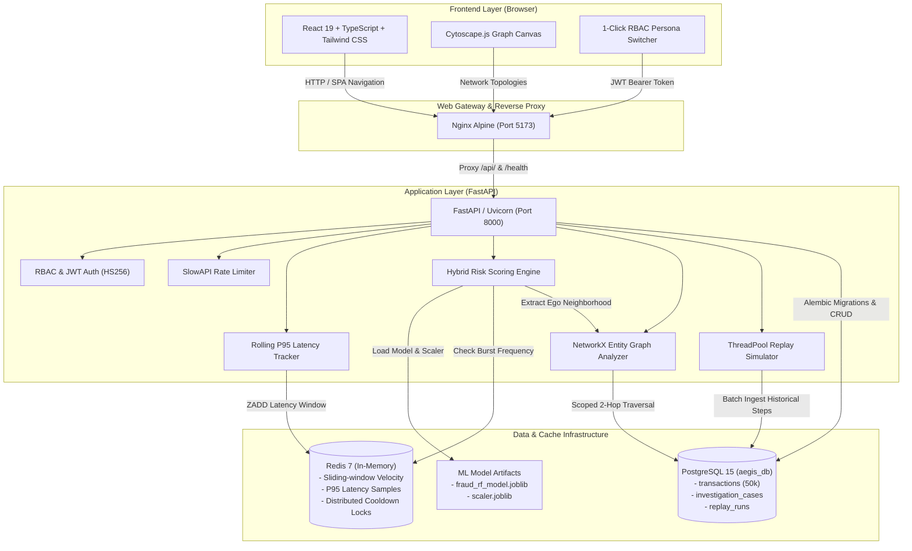

# AEGIS: Real-Time Financial Fraud Detection & Graph Intelligence Platform

> **Enterprise-grade transactional fraud detection, behavioral anomaly scoring, entity network graph intelligence, and analyst case management powered by Machine Learning and Redis.**

<p align="center">
  
</p>

<p align="center">
  
  
  
  
</p>
<p align="center">
  
  
  
  
</p>
<p align="center">
  
  
</p>

---

## Table of Contents

- [Overview & The Problem](#overview--the-problem)
- [Key Features](#key-features)
- [System Architecture](#system-architecture)
- [Technology Stack](#technology-stack)
- [Run This Project Lcoally!](#run-this-project-locally)
  - [Prerequisites](#prerequisites)
  - [1. Clone the Repository](#1-clone-the-repository)
  - [2. One-Click Docker Compose Setup](#2-one-click-docker-compose-setup-recommended)
  - [Bare-Metal Local Development Setup](#bare-metal-local-development-setup)
- [Database Management & Seeding](#database-management--seeding-mandatory-reference)
- [Configuration Reference](#configuration-reference)
- [Usage Guide & Primary Workflows](#usage-guide--primary-workflows)
- [API Reference](#api-reference)
- [Testing & Quality Assurance](#testing--quality-assurance)
- [Docker Architecture & Production Considerations](#docker-architecture--production-considerations)
- [Security & Access Control (RBAC)](#security--access-control-rbac)
- [Project Structure](#project-structure)
- [Known Limitations & Roadmap](#known-limitations--roadmap)
- [Contributing](#contributing)
- [License & Acknowledgments](#license--acknowledgments)

---

## Overview & The Problem

Financial institutions face sophisticated attacks: coordinated money mule rings, rapid account drains via mobile money emulators, and synthetic identity fraud. Conventional fraud management systems suffer from two major operational failures:

1. **Rigid Rule Engines:** Static Boolean rules produce high false-positive rates (alert fatigue), overwhelming compliance teams while failing to catch non-linear attack vectors.
2. **Opaque Black-Box ML:** Complex deep learning models output raw risk probabilities without auditable telemetry, making regulatory compliance and manual analyst adjudication impossible.

### The AEGIS Solution

**AEGIS** bridges statistical machine learning and operational triage into a high-performance, auditable platform:
- **Composite Scoring:** Merges calibrated Random Forest probabilities (trained on the PaySim financial dataset) with domain heuristics (account drain ratios, ledger discrepancies, and amount tiers).
- **Sub-Millisecond Velocity:** Uses Redis sorted sets to detect transaction bursts within rolling sliding windows.
- **Relational Graph Intelligence:** Leverages NetworkX to extract ego-networks across accounts, devices, and sessions, exposing multi-account mule syndicates in real time.
- **Auditable Analyst Experience:** Provides an interactive React 19 interface with Cytoscape.js network topologies, 1-click RBAC analyst personas, and an analyst feedback labeling loop for continuous model retraining.

---

## Key Features

### 1. Multi-Factor Hybrid Risk Engine
- Generates a continuous risk score between `0.01` and `0.99`.
- Evaluates transactions against policy thresholds:
  - **Approve:** `< 0.40`
  - **Review:** `0.40 - 0.74`
  - **Decline:** `≥ 0.75`
- Generates human-readable, auditable decision signals (e.g., *Critical Account Drain*, *Ledger Balance Discrepancy*, *High-Velocity Burst*, *Shared Device Syndicate*).
- Supports localized signal generation in both **English** and **Indonesian**.

### 2. High-Performance Velocity & Latency Observability
- Tracks account velocity within rolling sliding windows (e.g., transactions in 60s) via Redis sorted sets.
- Captures rolling P95 latency across API and model inference layers with sub-millisecond overhead.
- Features resilient in-memory local fallback (`collections.deque`) if Redis encounters connection latency.

### 3. Entity Graph Analysis & Ring Detection
- NetworkX-powered ego network generator connects transactions, accounts, hardware device IDs, and sessions up to 2 hops.
- Flags shared emulator devices (`DEV-SIM-XXX`) bridging distinct accounts.
- Interactive visualization using Cytoscape.js with force-directed layout and risk-color coding.

### 4. Investigation Command Center & Case Management
- Pre-populated triage queue displaying transactions requiring manual analyst review.
- Analyst feedback loop: investigators assign cases, add audit notes, and submit ground-truth labels (`confirmed_fraud`, `legitimate`, `inconclusive`).
- Full audit tracking with timestamps and investigator identity.

### 5. Model Lab & Historical Replay Simulator
- Backtests candidate decision thresholds against historical transaction data.
- Executes simulations asynchronously via an isolated worker pool.
- Computes counterfactual confusion matrices, precision, recall, and false-positive workload estimates before deploying model updates to production.

### 6. Zero-Friction Role-Based Access Control (RBAC)
- 1-click demo persona switcher issuing RFC 7519 HMAC-SHA256 JWT bearer tokens:
  - **Senior Fraud Specialist (`senior_analyst`):** Full triage, ground-truth labeling, simulation execution, and demo state reset authority.
  - **Compliance Officer (`compliance_officer`):** Operational review, case notes, and simulation execution (cannot modify model training labels).
  - **Guest Auditor (`auditor_readonly`):** Read-only inspection of metrics, transaction logs, and graph topologies.
- Enforced on backend endpoints using FastAPI dependency factories (`require_permission`).

### 7. Dual-Language Localization (i18n)
- Native switching between **English (EN)** and **Bahasa Indonesia (ID)** across all views, modals, metrics, and backend-generated anomaly descriptions.

---

## System Architecture



### Architectural Decisions & Trade-Offs

- **Hybrid Model + Heuristic Engine:** Pure machine learning models can struggle with cold starts, unseen attacks, and zero-day balance ledger inconsistencies. Augmenting Random Forest probabilities with continuous pattern heuristics (e.g. account drain ratio, origin/dest ledger balance mismatches) provides robust, explainable scoring.
- **Redis Sorted Sets for Velocity:** In-database `COUNT(*)` queries on recent transactions cause lock contention under high write loads. Redis sliding-window sorted sets (`ZADD` / `ZREMRANGEBYSCORE`) process velocity checks in sub-millisecond time.
- **Scoped Graph Traversal:** Rather than holding an entire 50,000+ transaction graph in active application memory, the graph engine queries 1-hop and 2-hop connected neighborhoods directly from indexed PostgreSQL records on demand.
- **Nginx Local Reverse Proxy:** Running Nginx in front of the SPA serves static assets with optimal caching, proxies `/api/v1` to the FastAPI backend, and eliminates cross-origin browser issues without exposing internal container ports.

---

## Technology Stack

### Core Technologies

| Technology | Role | Version | Selection Rationale |
|---|---|---|---|
| **Python** | Backend Runtime | `3.11` | Stable ecosystem for scikit-learn, joblib, and high-performance asyncio. |
| **FastAPI** | REST API Framework | `0.110.0` | Asynchronous speed, automatic OpenAPI/Swagger documentation, and Pydantic validation. |
| **PostgreSQL** | Relational Database | `15` | ACID compliance, robust indexing on timestamp/type/risk, and relational integrity for cases and transactions. |
| **Redis** | In-Memory Cache | `7.0` | Ultra-low latency sliding-window velocity tracking and distributed cooldown locks. |
| **Scikit-Learn** | Machine Learning | `1.8.0` | Balanced Random Forest classification optimized for tabular, imbalanced fraud data. |
| **NetworkX** | Graph Analytics | `3.2.1` | Efficient ego-network generation and entity relationship analysis across accounts and devices. |
| **React** | Frontend UI | `19.2.8` | Modern declarative component architecture, concurrent rendering, and reactive state management. |
| **Vite** | Frontend Build Tool | `8.3.0` | Near-instant HMR (Hot Module Replacement) and optimized production asset compilation. |
| **TypeScript** | Type Safety | `~6.0.2` | Static type guarantees across API schemas, persona states, and graph rendering logic. |
| **Tailwind CSS** | Styling System | `4.3.3` | Modern utility-first CSS engine with dark mode theme support. |
| **Cytoscape.js** | Graph Visualization | `3.34.3` | High-performance canvas-based network graph rendering for investigating mule rings. |
| **Docker & Compose** | Container Orchestration | Compose `v2` | Multi-container isolated runtime ensuring complete reproducibility across environments. |

### Development & Tooling

| Tool | Purpose | Version |
|---|---|---|
| **Alembic** | Database Schema Migrations | `1.13.1` |
| **Pytest** | Backend Test Runner | `8.1.1` |
| **Vitest** | Frontend Test Runner | `5.0.5` |
| **SlowAPI** | In-Memory / Redis API Rate Limiting | `0.1.10` |
| **Axios** | HTTP Client with Interceptors | `1.20.0` |
| **TanStack Query** | Server State Synchronization | `5.104.2` |

---

## Run This Project Locally!

### Prerequisites

Ensure the following tools are installed on your host machine:
- **Git:** `2.30+`
- **Docker Engine:** `24.0+` or **Docker Desktop:** `4.20+`
- **Docker Compose:** `v2.20+`
- *(Optional for bare-metal host development)*: Python `3.11+` and Node.js `20+ LTS` / `22+`.

---

### 1. Clone the Repository

Clone the repository to your local machine and navigate into the project directory:

```bash
git clone https://github.com/razeequtama/aegis-fraud-detection.git
cd aegis-fraud-detection
```

> [!TIP]
> If you already have a local clone, ensure your working tree is clean and pull the latest changes before starting:
> ```bash
> git checkout main
> git pull origin main
> ```

---

### 2. One-Click Docker Compose Setup (Recommended)

The repository provides automated startup scripts that configure environment files (automatically copying `.env.example` to `.env` if not present), build and start all containers in detached mode, execute database migrations, seed initial data via `backend-init`, and wait for the frontend to become healthy on `http://localhost:5173`.

#### On Windows (PowerShell / Command Prompt):
```powershell
.\start.ps1
# Or double-click start.bat
```

#### On Linux / macOS (Bash):
```bash
chmod +x start.sh
./start.sh
```

#### Using Make:
```bash
make up
```

#### Manual Docker Compose Command:
If you prefer running standard Docker commands manually:
```bash
# 1. Copy environment template
cp .env.example .env

# 2. Build and start services in detached mode (handles migrations + seeding automatically)
docker compose up --build -d
```

### Accessing the Running Application

| Service / Interface | URL | Credentials / Notes |
|---|---|---|
| **Frontend Web Application** | [http://localhost:5173](http://localhost:5173) | Click **Persona Switcher** in header to choose an analyst role |
| **Interactive API Docs (Swagger UI)** | [http://localhost:8000/docs](http://localhost:8000/docs) | Complete interactive endpoint testing suite |
| **Alternative API Docs (ReDoc)** | [http://localhost:8000/redoc](http://localhost:8000/redoc) | Clean API contract documentation |
| **Backend Health Check** | [http://localhost:8000/api/v1/health](http://localhost:8000/api/v1/health) | Returns DB, Redis, and ML model status |
| **PostgreSQL Host Port** | `127.0.0.1:5434` | Bound strictly to loopback (`aegis_user` / `aegis_db`) |

To view container logs at any time:
```bash
docker compose logs -f
# Or via Makefile:
make logs
```

To stop all services:
```bash
docker compose down
# Or via Makefile:
make down
```

---

### Bare-Metal Local Development Setup

If you prefer to run services outside Docker on your host machine, clone the repository first (as shown in Step 1) and execute the following steps from the project root:

#### 1. Start External Infrastructure (PostgreSQL & Redis)
Ensure PostgreSQL is running on port `5432` (or `5434`) and Redis on port `6379`. You can use Docker just for these dependencies:
```bash
docker compose up -d db redis
```

#### 2. Backend Setup
```bash
cd backend

# Create virtual environment
python -m venv .venv
# Activate on Windows:
.venv\Scripts\activate
# Activate on Linux/macOS:
source .venv/bin/activate

# Install dependencies
pip install -r requirements.txt

# Run migrations
alembic upgrade head

# Seed initial transactions and cases
python -m app.db.seed

# Start FastAPI development server
uvicorn app.main:app --host 127.0.0.1 --port 8000 --reload
```

#### 3. Frontend Setup
```bash
cd frontend

# Install Node dependencies
npm install

# Start Vite development server
npm run dev
```
The frontend dev server will start at `http://localhost:5173` with proxying to `http://127.0.0.1:8000`.

---

## Database Management & Seeding (Mandatory Reference)

The AEGIS database lifecycle is engineered for strict safety, idempotency, and environment separation.

### 1. Seed Implementation
The database seed logic is implemented in [backend/app/db/seed.py](file:///d:/Projects/aegis_fraud_detection/backend/app/db/seed.py). It operates via a hierarchical strategy:
- **Strategy 1 (Primary):** Checks for pre-computed, compressed transactions at `database/seeds/transactions.csv.gz` (or `SEED_DATA_PATH`). Contains 50,000 transactions sampled from the PaySim dataset with pre-calculated risk scores and emulator identifiers.
- **Strategy 2 (Dynamic Fallback):** If the gzipped file is absent, it loads raw PaySim data from `ml/data/ps.csv`, extracts all fraudulent transactions and a balanced sample of legitimate records, computes continuous risk scores using `risk_engine.predict_proba_batch()`, and bulk-inserts them.
- **Curated Cases:** Populates 9 curated sample investigation cases covering all operational statuses (`confirmed_fraud`, `inconclusive`, `legitimate`, `open`), then maps all unassigned transactions with risk scores between `0.40` and `0.74` into `investigation_cases` for manual triage.

### 2. Exact Commands
- **In Docker Compose:** Automated on startup by the ephemeral `backend-init` service (`sh -c "alembic upgrade head && python -m app.db.seed"`).
- **Via Make:**
  ```bash
  make seed
  ```
- **Via Docker Exec:**
  ```bash
  docker compose exec backend python -m app.db.seed
  ```
- **Reset Demo State:**
  ```bash
  make reset-demo
  # Or:
  docker compose exec backend python -m app.db.seed --reset
  ```

### 3. Execution Order
1. **Database Container Health:** PostgreSQL must be healthy and accepting connections.
2. **Schema Migrations:** Alembic migrations **must run before seeding** (`alembic upgrade head`). The tables `transactions`, `investigation_cases`, and `replay_runs` must exist.
3. **Application State:** In Docker, `backend-init` finishes seeding before the `backend` container starts (`condition: service_completed_successfully`). If running manually, the backend app does not need to be active.

### 4. Prerequisites
- `DATABASE_URL` environment variable properly configured.
- `ML_ARTIFACTS_DIR` set to directory containing `fraud_rf_model.joblib` and `scaler.joblib`.
- Sufficient disk space for PostgreSQL tables (~40MB for 50,000 transactions and indexes).

### 5. Initial Data Created
- **50,000 Transactions:** Spread across types `TRANSFER`, `CASH_OUT`, `PAYMENT`, `CASH_IN`, and `DEBIT`, spanning 744 chronological hourly steps (31 days).
- **15,837 Investigation Cases:**
  - 9 curated reference cases with realistic analyst reasoning and ground-truth labels.
  - ~15,828 review-tier cases (`risk_score` between `0.40` and `0.74`) flagged as `'Unassigned'` and `'open'`.
- **Demo Personas:** 3 pre-configured RBAC roles available for immediate evaluation without credential entry.

### 6. Repeatability & Idempotency
- Running `python -m app.db.seed` multiple times is **completely safe and idempotent**.
- It runs `SELECT count(*) FROM transactions`. If transactions already exist, it skips bulk insertion and ensures case records exist using `ON CONFLICT (case_id) DO NOTHING` and `NOT IN (...)` guards.

### 7. Data Safety & Destructive Behavior
- **Standard Seed (`seed_if_empty()`):** Strictly non-destructive append-only. Never deletes or drops existing records.
- **Demo State Reset (`--reset`):** Destructive **only** to volatile demonstration state:
  - Deletes all records from `investigation_cases`.
  - Clears `FAILED` or `QUEUED` records from `replay_runs`.
  - Re-seeds the baseline curated cases.
  - **Preserves all 50,000 transactions.** The `transactions` table is never truncated or dropped during a demo reset.
- **Full Database Purge:** The only destructive operation that deletes all transactions is running `docker compose down -v` or `make clean`, which destroys the persistent volume `postgres_data`.

### 8. Environment Separation
- **Development & Demo (`APP_ENV=development` or `APP_ENV=demo`):** Seeding runs automatically. Reset commands are permitted via UI and CLI.
- **Production (`APP_ENV=production`):** Running `reset_demo_state()` raises a strict `PermissionError`:
  > *"Demo state reset is strictly forbidden in production environments (APP_ENV=production)."*
  The automated 24-hour background demo reset worker is permanently disabled in production.

### 9. Persistence
- Database files reside in the named Docker volume `postgres_data` mapped to `/var/lib/postgresql/data`.
- Seeded data survives container restarts (`docker compose restart`), stops (`docker compose down`), and host reboots.
- Only explicit volume removal (`docker compose down -v`) deletes the database.

### 10. Verification Command
To verify that database seeding succeeded, run:
```bash
docker compose exec backend python -c "from app.db.session import engine; from sqlalchemy import text; 
with engine.connect() as c:
    tx = c.execute(text('SELECT count(*) FROM transactions')).scalar()
    cs = c.execute(text('SELECT count(*) FROM investigation_cases')).scalar()
    print(f'Verification: {tx} transactions, {cs} cases verified.')"
```
**Expected Output:**
```
Verification: 50000 transactions, 15837 cases verified.
```

---

## Configuration Reference

All settings can be configured via environment variables or a local `.env` file created from `.env.example`:

| Variable | Service | Required? | Default / Safe Value | Purpose |
|---|---|---|---|---|
| `POSTGRES_USER` | Database | Yes | `aegis_user` | PostgreSQL administrative username. |
| `POSTGRES_PASSWORD` | Database | Yes | *(Generate random password)* | PostgreSQL user password. |
| `POSTGRES_DB` | Database | Yes | `aegis_db` | Primary database name. |
| `POSTGRES_HOST` | Backend | Yes | `db` | Database hostname inside Docker network. |
| `POSTGRES_PORT` | Backend | Yes | `5432` | Internal database port. |
| `DATABASE_URL` | Backend | Yes | `postgresql+psycopg2://...` | Full SQLAlchemy database connection URI. |
| `POSTGRES_HOST_PORT` | Compose | No | `5434` | Host port mapped to PostgreSQL loopback (`127.0.0.1`). |
| `REDIS_HOST` | Backend | Yes | `redis` | Redis service host. |
| `REDIS_PORT` | Backend | Yes | `6379` | Redis internal port. |
| `REDIS_PASSWORD` | Backend/Redis | Yes | *(Generate random password)* | Password for Redis AUTH authentication. |
| `ML_ARTIFACTS_DIR` | Backend | Yes | `/ml/artifacts` | Path to directory containing `.joblib` model files. |
| `APP_ENV` | Backend | Yes | `development` | Environment mode: `development`, `demo`, or `production`. |
| `DEBUG` | Backend | No | `true` | Enables verbose FastAPI logging. |
| `JWT_SECRET_KEY` | Backend | Yes | *(Min 32 characters)* | Secret used to sign RFC 7519 HMAC-SHA256 tokens. |
| `JWT_EXPIRATION_SECONDS` | Backend | No | `86400` (24h) | JWT access token validity period. |
| `ALLOWED_ORIGINS` | Backend | No | `http://localhost:5173,...` | Comma-separated list of allowed CORS origins. |
| `VITE_BACKEND_URL` | Frontend | No | `http://backend:8000` | Target backend host used by Nginx/Vite proxy. |
| `VITE_API_BASE_URL` | Frontend | No | `http://backend:8000/api/v1` | Explicit API endpoint base URL. |

---

## Usage Guide & Primary Workflows

### 1. Selecting an Analyst Persona
Open [http://localhost:5173](http://localhost:5173). In the top header bar, click the **Persona Selector**:
- Switch to **Senior Fraud Specialist (Sarah Jenkins)** for unrestricted capabilities.
- Notice the persona badge and permissions update dynamically.

### 2. Exploring Transactions
1. Navigate to **Transactions** in the navigation bar.
2. Filter transactions by:
   - **Risk Tier:** `All`, `Approve (< 0.40)`, `Review (0.40 - 0.74)`, or `Decline (≥ 0.75)`.
   - **Transaction Type:** `TRANSFER`, `CASH_OUT`, `PAYMENT`, `CASH_IN`, `DEBIT`.
   - **Amount Range:** Minimum / Maximum amounts.
   - **Search:** Query by `TX-XXXXX`, account ID (`CXXXXX`), or emulator device (`DEV-SIM-XXX`).
3. Click any transaction row to open its detailed assessment view.

### 3. Visualizing Network Mule Syndicates
1. Open transaction `TX-100463` or navigate directly to **Network Intelligence**.
2. Select preset: **"Shared Emulator Syndicate"**.
3. Observe the force-directed Cytoscape.js graph:
   - Central red transaction node connects to the origin account.
   - The origin account shares emulator node `DEV-SIM-995` with multiple other high-risk accounts.
   - Toggle the radius (1 to 3 hops) to expand the syndicate ring.

### 4. Adjudicating an Investigation Case
1. Navigate to **Investigation Cases**.
2. Select an open case (e.g. `CASE-140135`).
3. Inspect transaction metadata, origin account balance drain, and anomaly signals.
4. Update case status to `in_review` and assign to yourself.
5. In the **Analyst Adjudication** panel:
   - Select feedback label: **"Confirm Fraud"** or **"Mark Legitimate"**.
   - Input your audit reasoning (e.g., *"Confirmed emulator device reuse and 100% balance depletion"*).
   - Click **Submit Final Feedback**.
   - The feedback is committed to PostgreSQL with your persona's ID for model training audit logs.

### 5. Running Historical Replay Simulations in the Model Lab
1. Navigate to **Model Lab**.
2. View active Random Forest metrics: **Precision 0.89**, **Recall 0.82**, **PR-AUC 0.85**.
3. In the **Simulation Thresholds** panel, adjust the candidate thresholds:
   - Move Decline Threshold from `0.75` to `0.80`.
   - Set historical evaluation window (e.g. Steps 1 to 100).
4. Click **Run Replay Simulation**.
5. The background worker evaluates candidate thresholds against historical records and returns estimated false positive vs. detection rates.

---

## API Reference

The FastAPI backend exposes an interactive OpenAPI specification at `http://localhost:8000/docs`. Key endpoints include:

### Risk Assessment

#### `POST /api/v1/risk-assessments`
Evaluates an incoming transaction in real time without persisting it.

**Request Payload:**
```json
{
  "transaction_id": "TX-10021",
  "account_id": "C429214117",
  "amount": 850000.00,
  "type": "TRANSFER",
  "oldbalanceOrg": 1089.00,
  "newbalanceOrig": 28.69,
  "oldbalanceDest": 0.00,
  "newbalanceDest": 0.00,
  "device_id": "DEV-SIM-021",
  "session_id": "SES-SIM-991",
  "payment_attempts": 2,
  "language": "en"
}
```

**Response Payload (`200 OK`):**
```json
{
  "transaction_id": "TX-10021",
  "risk_score": 0.8425,
  "decision": "decline",
  "model_version": "aegis-rf-0.1.0",
  "signals": [
    {
      "name": "high_fraud_probability",
      "description": "Composite risk model predicts a critical probability of fraudulent transaction activity."
    },
    {
      "name": "critical_account_drain",
      "description": "Near-total account drain detected: 78053.3% of balance withdrawn."
    },
    {
      "name": "high_value_transaction",
      "description": "Transaction amount (Rp 850,000.00) exceeds standard operational threshold."
    }
  ],
  "latency_ms": 3.82,
  "velocity": 1,
  "graph_metrics": {
    "shared_devices_count": 0.0,
    "node_degree": 0.0
  }
}
```

---

### Network Analysis

#### `GET /api/v1/transactions/{transaction_id}/network?radius=2`
Retrieves the ego-network graph around a transaction.

**Response (`200 OK`):**
```json
{
  "nodes": [
    {
      "id": "Transaction:TX-100463",
      "label": "Transaction:TX-100463",
      "type": "transaction",
      "suspicious": true,
      "shared": false
    },
    {
      "id": "Account:C1711670940",
      "label": "Account:C1711670940",
      "type": "account",
      "suspicious": true,
      "shared": false
    },
    {
      "id": "Device:DEV-SIM-995",
      "label": "Device:DEV-SIM-995",
      "type": "device",
      "suspicious": false,
      "shared": true
    }
  ],
  "edges": [
    {
      "source": "Transaction:TX-100463",
      "target": "Account:C1711670940",
      "relation": "performed_by"
    },
    {
      "source": "Account:C1711670940",
      "target": "Device:DEV-SIM-995",
      "relation": "uses_device"
    }
  ]
}
```

---

### Investigation Cases & Feedback

#### `POST /api/v1/cases/{case_id}/feedback`
*Requires Bearer Token with `label_feedback` permission.*

**Request Payload:**
```json
{
  "analyst_id": "analyst_sarah",
  "label": "confirmed_fraud",
  "reasoning": "Device emulator DEV-SIM-995 connects 53 distinct accounts. Confirmed account takeover ring."
}
```

---

## Testing & Quality Assurance

The repository includes test suites for both frontend and backend layers:

### Running Backend Tests (Pytest)
The backend test suite contains **56 automated unit and integration tests** verifying authentication, RBAC enforcement, rate limiting, demo reset safety, graph traversals, and risk calculations.

```bash
# Inside running container:
make test-backend
# Or:
docker compose exec backend pytest

# On host virtual environment:
cd backend && pytest
```

**Verified Test Result:**
```
============================= test session starts ==============================
collected 56 items

tests/test_auth_rbac.py .....                                            [  8%]
tests/test_demo_reset_safety.py ......                                   [ 19%]
tests/test_graph_analysis.py ...                                         [ 25%]
tests/test_investigation.py ...                                          [ 30%]
tests/test_metrics.py .......                                            [ 42%]
tests/test_migrate_enrich.py ..                                          [ 46%]
tests/test_observability.py ...                                          [ 51%]
tests/test_perf02_func01_indexes_and_graph.py ....                       [ 58%]
tests/test_replay_engine.py ...                                          [ 64%]
tests/test_replays.py ..                                                 [ 67%]
tests/test_risk_assessment.py ...........                                [ 87%]
tests/test_transactions.py .......                                       [100%]

======================= 56 passed in 15.88s ========================
```

### Running Frontend Tests (Vitest)
The frontend test suite tests client API configuration, token interception, and authentication headers.

```bash
# Run tests:
make test-frontend
# Or:
npm test --prefix frontend
```

**Verified Test Result:**
```
 RUN  v5.0.5 D:/Projects/aegis_fraud_detection/frontend
 ✓ src/api/client.test.ts (4 tests) 10ms

 Test Files  1 passed (1)
      Tests  4 passed (4)
```

### Frontend Linting & Type Checking
```bash
npm run lint --prefix frontend
npm run build --prefix frontend
```

---

## Docker Architecture & Production Considerations

### Container Topology

```
+------------------------------------------------------------------------------------+
| Docker Network: aegis_network (bridge)                                             |
|                                                                                    |
|  +-------------------+       +--------------------+       +---------------------+  |
|  |   aegis_postgres  |       |    aegis_redis     |       |     backend-init    |  |
|  | (postgres:15-alp) |       |   (redis:7-alp)    |       |   (python:3.11-sl)  |  |
|  | Port: 5432 (int)  |       | Port: 6379 (int)   |       | alembic + seed      |  |
|  +--------^----------+       +---------^----------+       +----------^----------+  |
|           |                            |                             |             |
|           +----------------------------+-----------------------------+             |
|                                        |                                           |
|                              +---------+----------+                                |
|                              |   aegis_backend    |                                |
|                              |  (FastAPI/Uvicorn) |                                |
|                              | Port: 8000 (int)   |                                |
|                              +---------^----------+                                |
|                                        |                                           |
|                              +---------+----------+                                |
|                              |   aegis_frontend   |                                |
|                              |   (Nginx Alpine)   |                                |
|                              | Port: 5173 (ext)   |                                |
|                              +--------------------+                                |
+------------------------------------------------------------------------------------+
         |                                                 |
         v                                                 v
  Host: 127.0.0.1:5434                              Host: 0.0.0.0:5173
  (Loopback DB access)                              (Frontend Web Interface)
```

### Security Isolation in Docker
1. **Loopback Binding for Sensitive Ports:**
   - PostgreSQL is mapped to `127.0.0.1:5434` (never to `0.0.0.0`), preventing public database access on multi-homed hosts.
   - Backend Uvicorn is bound to `127.0.0.1:8000`.
   - Redis has **no published host ports** and communicates strictly within `aegis_network` with password enforcement.
2. **Non-Root Execution:** Both `backend/Dockerfile` and `frontend/Dockerfile` enforce non-root system users (`appuser:10001`) with read-only runtime mounts where applicable.
3. **Multi-Stage Builds:** Development compilers (`gcc`, `libpq-dev`, `build-essential`) are stripped in the builder stage, producing lightweight production images.

### Production Readiness Checklist
Before deploying this repository to a production environment:
- [ ] Set `APP_ENV=production` in the environment configuration.
- [ ] Generate strong, random secrets for `JWT_SECRET_KEY`, `POSTGRES_PASSWORD`, and `REDIS_PASSWORD` (`openssl rand -hex 32`).
- [ ] Terminate TLS/HTTPS at an enterprise load balancer (e.g. AWS ALB, Cloudflare, Traefik).
- [ ] Store session JWT tokens in `HttpOnly`, `Secure`, `SameSite=Strict` cookies instead of browser storage.
- [ ] Migrate database persistence to managed clusters (e.g. AWS Aurora PostgreSQL, GCP Cloud SQL).
- [ ] Offload replay simulations and heavy batch scoring to asynchronous Celery or temporal worker queues.

---

## Security & Access Control (RBAC)

### 1. Authentication Model
AEGIS implements an RFC 7519 HMAC-SHA256 JWT bearer token mechanism. The demo authentication service (`/api/v1/auth/demo-login`) allows frictionless switching between realistic analyst personas while verifying cryptographic signatures on every protected endpoint.

### 2. RBAC Permission Matrix

| Permission | Senior Fraud Specialist | Compliance Officer | Guest Auditor |
|---|:---:|:---:|:---:|
| `view` (Inspect dashboards, metrics, graphs) | Yes | Yes | Yes |
| `edit_case` (Reassign cases, add audit notes) | Yes | Yes | No |
| `label_feedback` (Submit ground-truth labels) | Yes | No | No |
| `run_replay` (Execute Model Lab simulations) | Yes | Yes | No |
| `reset_demo` (Trigger demo sandbox reset) | Yes | No | No |

### 3. HTTP Security Headers
All API responses include strict security headers via ASGI middleware:
```http
X-Content-Type-Options: nosniff
X-Frame-Options: DENY
X-XSS-Protection: 1; mode=block
Referrer-Policy: strict-origin-when-cross-origin
```

### 4. Rate Limiting
Public risk evaluation and simulation endpoints are protected against denial-of-service via SlowAPI:
- `POST /api/v1/risk-assessments`: 30 requests / minute
- `POST /api/v1/replays`: 2 requests / minute
- `POST /api/v1/system/reset-demo`: 1 request / 15 minutes + Redis distributed cooldown lock

---

## Project Structure

```
aegis_fraud_detection/
├── backend/                       # FastAPI application & ML service
│   ├── alembic/                   # Database migrations
│   │   └── versions/              # Migration scripts (001_initial, 002_perf_indexes)
│   ├── app/
│   │   ├── api/                   # API routers and endpoints
│   │   │   ├── deps.py            # RBAC dependency factories & auth extraction
│   │   │   └── routes/            # Route modules (auth, risk, cases, network, etc.)
│   │   ├── core/                  # Security, Redis client, rate limiter
│   │   ├── db/                    # Session management, seed scripts, enrichers
│   │   │   ├── seed.py            # Automated idempotent database seeder
│   │   │   └── session.py         # SQLAlchemy engine & session factory
│   │   ├── models/                # SQLAlchemy ORM models (transactions, cases, replays)
│   │   ├── schemas/               # Pydantic request & response validation schemas
│   │   ├── services/              # Business logic services
│   │   │   ├── graph_analysis.py  # NetworkX entity relationship analyzer
│   │   │   ├── observability.py   # Redis sliding-window P95 latency tracking
│   │   │   ├── replay_engine.py   # Historical replay simulation worker
│   │   │   └── risk_engine.py     # Hybrid ML + domain heuristic risk scorer
│   │   └── main.py                # FastAPI ASGI application factory & lifespan
│   ├── tests/                     # 56 Pytest integration & unit test suites
│   ├── Dockerfile                 # Multi-stage non-root Python 3.11 runtime
│   └── requirements.txt           # Python dependency manifest
├── database/
│   └── seeds/
│       └── transactions.csv.gz    # Pre-computed gzipped seed dataset (50k rows)
├── docs/                          # Technical specifications
│   ├── api.md                     # Complete API contract specification
│   └── data-dictionary.md         # PaySim feature mapping & definitions
├── frontend/                      # React 19 single-page application
│   ├── public/                    # Static assets, SVG icons, and logos
│   ├── src/
│   │   ├── api/                   # Axios client, interceptors, and mock handlers
│   │   ├── components/            # UI components (Layout, PersonaSwitcher, Modals)
│   │   ├── context/               # Global state (Auth, Notification context)
│   │   ├── i18n/                  # English and Indonesian translation dictionaries
│   │   ├── pages/                 # Route views (Dashboard, Cases, Network, Lab)
│   │   ├── App.tsx                # React Router root tree
│   │   └── main.tsx               # Client entry point
│   ├── Dockerfile                 # Multi-stage Node 22 build -> Nginx Alpine
│   ├── nginx.conf                 # Nginx SPA & API reverse proxy configuration
│   ├── package.json               # Node dependencies & npm scripts
│   └── vite.config.ts             # Vite build configuration with Tailwind v4
├── ml/                            # Machine learning pipeline
│   ├── artifacts/                 # Pre-trained Random Forest model & Scaler
│   │   ├── fraud_rf_model.joblib  # Trained scikit-learn classifier
│   │   └── scaler.joblib          # StandardScaler fitted on training features
│   ├── data/                      # Dataset directory (ps.csv PaySim source)
│   └── src/                       # Data preprocessing and training scripts
├── docker-compose.yml             # Primary multi-service Docker configuration
├── Makefile                       # Unified developer workflow CLI
├── start.bat                      # 1-Click Windows Command Prompt launcher
├── start.ps1                      # 1-Click Windows PowerShell launcher
└── start.sh                       # 1-Click Linux / macOS Bash launcher
```

---

## Known Limitations & Roadmap

### Current Limitations
1. **In-Memory Graph Analyzer:** The entity graph is generated dynamically from 2-hop SQL queries and analyzed via NetworkX in memory. For organizations processing > 10 million interconnected entities, a dedicated distributed graph database (e.g. Neo4j or Amazon Neptune) should replace NetworkX.
2. **Single-Node Replay Worker:** Historical simulation runs execute within a Python `ThreadPoolExecutor`. In high-concurrency production deployments, replays should run on Celery or Redis Streams workers.
3. **Static Seed Window:** Seed transactions cover 744 simulated hours (31 days). Real-time continuous transaction streaming (e.g. Kafka ingestion) is not bundled in this demonstration package.

### Engineering Roadmap
- [ ] **Apache Kafka Ingestion:** Ingest simulated ISO 8583 payment messages directly through Kafka topics.
- [ ] **Continuous Active Learning:** Automatically trigger model re-training jobs when analyst ground-truth labels reach threshold volume.
- [ ] **GNN Embeddings:** Introduce Graph Neural Networks (PyTorch Geometric) for continuous structural node embeddings alongside tabular Random Forest predictions.

---

## Contributing

1. Fork the repository and create your feature branch:
   ```bash
   git checkout -b feature/fraud-signal-enhancement
   ```
2. Ensure all backend and frontend tests pass:
   ```bash
   make test
   ```
3. Run code formatting and linter checks:
   ```bash
   npm run lint --prefix frontend
   ```
4. Submit a clear Pull Request detailing your changes and test coverage.

---

## License & Acknowledgments

- **Dataset Attribution:** This platform utilizes the **PaySim Synthetic Financial Datasets for Fraud Detection**, created by Edgar Lopez-Rojas et al. and distributed under the [Creative Commons Attribution 4.0 International (CC BY 4.0)](https://creativecommons.org/licenses/by/4.0/) license.
- **Core Open-Source Projects:** Built on the shoulders of giants: [FastAPI](https://fastapi.tiangolo.com/), [Scikit-Learn](https://scikit-learn.org/), [React](https://react.dev/), [Cytoscape.js](https://js.cytoscape.org/), [NetworkX](https://networkx.org/), [Tailwind CSS](https://tailwindcss.com/), and [PostgreSQL](https://www.postgresql.org/).
- **Evaluation Notice:** AEGIS is developed as an engineering portfolio and demonstration platform. All simulated bank account numbers, transactions, and devices are synthetic.

